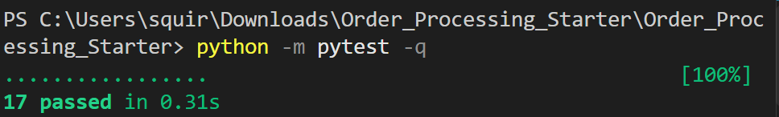
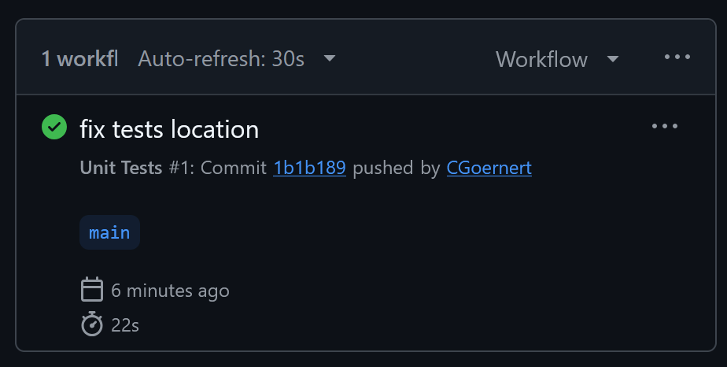
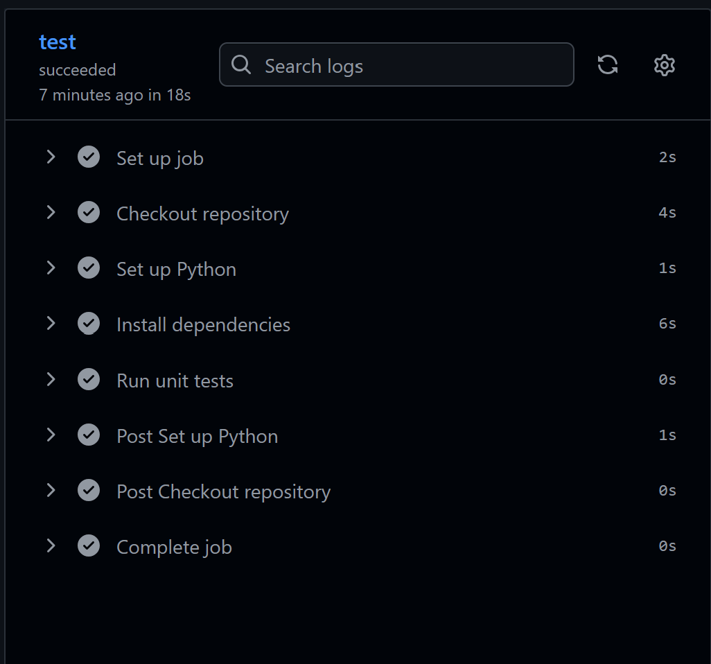

# Reliable Programming and Unit Testing Lab

## Task 1  Defects and Fixes

### Defect 1  Invalid Item Quantities
**File:** `cart.py` **func** `add_item()`

The method allowed zero, negative, and non-integer quantities to be added to the cart. This could cause incorrect item quantities and totals.

**Fix:** Added validation to ensure quantities are positive integers before adding items.

### Defect 2  Duplicate Products Exceeding Stock
**File:** `cart.py` **func** `add_item()`

The stock check only considered the new quantity being added, ignoring items already in the cart. This allowed the total quantity to exceed available stock.

**Fix:** Changed the stock check to include both the existing cart quantity and the new quantity.

### Defect 3  Invalid Removal Quantities
**File:** `cart.py` **func** `remove_item()`

The method accepted negative quantities, which could increase the number of items in the cart instead of removing them.

**Fix:** Added validation to reject zero, negative, and non-integer removal quantities.

### Defect 4  Discount Not Updated After Cart Changes
**File:** `cart.py` **func** `add_item()` and `remove_item()`

After applying a discount, adding or removing products did not update the discounted total. This could cause customers to be charged an incorrect amount.

**Fix:** Modified both methods to automatically reapply the active discount whenever the cart contents change.

### Defect 5  Incorrect Discount Stacking
**File:** `cart.py` **func** `apply_discount()`

Applying a second discount used the previously discounted total instead of the original subtotal. This allowed discounts to stack.

**Fix:** Changed the discount calculation to use `self.subtotal()` instead of `self.total()`.

### Defect 6  Negative Discounted Totals
**File:** `cart.py` **func** `apply_discount()`

The `SAVE15` discount could reduce the cart total below zero when the subtotal was less than $15.

**Fix:** Used `max(0, amount)` when storing the discounted total to prevent negative totals.

### Defect 7  Duplicate Items When Loading Saved Carts
**File:** `cart.py` **func** `load()`

Loading a saved cart multiple times added the saved items repeatedly instead of replacing the current cart contents.

**Fix:** Cleared the existing cart items and discount information before loading the saved cart.

### Defect 8  SQL Injection Vulnerabilities
**File:** `repository.py` **func** `get_product()` and `get_saved_cart()`

Both methods constructed SQL queries using user-provided values. This could allow SQL injection and unintended access to database records.

**Fix:** Replaced string interpolation with parameterized SQL queries using `?` placeholders.

## Task 2  Unit Testing

Created 15 new pytest unit tests in `tests/test_defects.py` to verify the corrected behavior.

The tests cover quantity validation, duplicate products, stock limits, item removal, discount calculations, saved-cart loading, and SQL injection prevention.

**Command used:**

`python -m pytest -q`

**Local test results:**

All 17 tests passed successfully.

## Task 3  GitHub Actions

Created `.github/workflows/tests.yml` to automatically run unit tests on every push and pull request.

The workflow:
- Checks out the repository.
- Sets up Python 3.11.
- Installs dependencies from `requirements.txt`.
- Executes `python -m pytest -q`.

**Result:** 

**Successful workflow:** https://github.com/CGoernert/A01417523-Security-and-Reliable-Programming/actions

## Assumptions

- Only one discount code is active at a time.
- Active discounts are automatically recalculated when cart contents change.
- Loading a saved cart replaces the current cart contents.